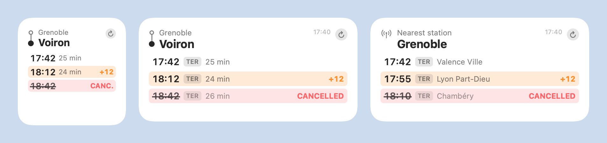
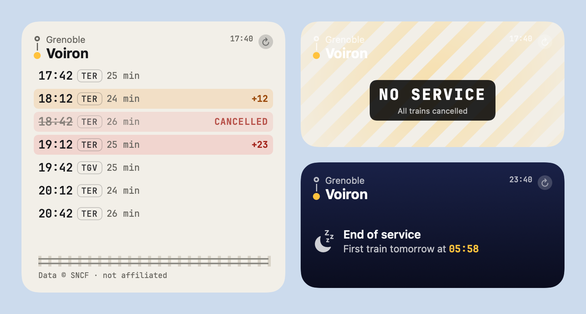

# Trains near me

[](https://github.com/Wonskcalb/trains-near-me/actions/workflows/ci.yml)
[](https://github.com/Wonskcalb/trains-near-me/releases/latest)


[](LICENSE)

Native macOS and iOS widgets showing the next SNCF trains, with real-time delays and cancellations from the official SNCF API. Two widgets:

- **Trip** — the next **direct** trains for one journey (e.g. Grenoble → Voiron).
- **Radar** — the next departures from the station closest to you, in every direction.

<picture>
  <source media="(prefers-color-scheme: dark)" srcset="Design/widget-dark.png">
  
</picture>

- **Pure Swift:** SwiftUI, WidgetKit, App Intents and Core Location. No third-party dependencies.
- **No backend:** the device talks only to `api.sncf.com` and Apple's location services.
- **One journey per Trip widget:** pick the two stations in the widget's own settings.
  - **Direction:** fixed, reversed, or automatic. Automatic flips the journey at a switch time, 13:00 by default.
  - **Nearest station:** optionally, the configured station closest to you becomes the departure. That comparison is made on the device; nothing is sent.
- **Radar has nothing to configure:** it follows you. To find the station around you it sends your position, rounded to three decimals (about 100 m), to the SNCF API. That is the only case where a position leaves the device.
- **Lock Screen on iOS:** both widgets also come in the rectangular and circular accessory sizes.

**Just want to use it?** Follow the step-by-step guide: [GUIDE.md](GUIDE.md). You'll need Xcode and a free Apple account, and one script does the build and install:

```bash
sh scripts/install.sh
```

> Not affiliated with SNCF. Train data © SNCF, via the [SNCF open data API](https://numerique.sncf.com/startup/api/).

## Setup

Requires Xcode 16 or later, and macOS 15 or iOS 18 or later.

1. **Get a free SNCF API token** at <https://numerique.sncf.com/startup/api/token-developpeur/>. The free tier allows 5,000 requests per day.
2. **Set your signing team.** A free Personal Team is enough to run the widget on your own Mac:
   ```bash
   cp Config/Local.xcconfig.example Config/Local.xcconfig
   ```
   Then edit `DEVELOPMENT_TEAM` and `BUNDLE_ID_PREFIX`. Both targets read them, so they always share the same App Group, which is how the widget reads the token.
3. **Open `TrainsNearMe.xcodeproj` and run the `TrainsNearMe` scheme.** In the window:
   - paste the token and click **Save and test**;
   - accept the location prompt if you want nearest-station mode.
4. **Add a widget:** right-click the desktop › **Edit Widgets** › **Trains near me** › **Trip** or **Radar**. For Trip, right-click the widget › **Edit** to pick the stations.

### On iPhone or iPad

Same project, same scheme: pick your device in Xcode and run. Two differences:

- **The token is compiled in.** A free Apple account cannot use App Groups on iOS, so the app and the widget cannot share what you type in the app. Put the token in `Config/Local.xcconfig` instead:
  ```
  SNCF_TOKEN = 3b036afe-0110-4202-b9ed-99718476c2e0
  ```
  then build again. The app shows whether the build carries a token.
- **Location** is asked for at first launch, as on macOS; Radar needs it.

The Xcode project is generated from `project.yml` with [XcodeGen](https://github.com/yonaskolb/XcodeGen). After editing `project.yml`, regenerate it:

```bash
brew install xcodegen
```

```bash
xcodegen generate
```

## Layout

```
SNCFCore/   Swift package: domain model, SNCF client + parser, direction/position logic, refresh plan, tests
Widget/     Widget extension: App Intent configuration, timeline provider, SwiftUI views
App/        Host app: stores the API token (macOS), requests location permission (one window)
Config/     Shared build settings; Local.xcconfig (git-ignored) holds your team id
Design/     App icon renderer, widget screenshot renderer and the rendered images
scripts/    install.sh (build + install), render-screenshots.sh
```

## Display

**Rows** show the scheduled time, then the journey duration (Trip) or the train's direction (Radar), and a status:

| Status | Row style | Badge |
|---|---|---|
| Delay of 0–10 min | Plain | — |
| Delay of 11–19 min | Orange tint | e.g. `+12` |
| Delay of 20 min or more | Red tint | e.g. `+23` |
| Cancelled | Red tint, struck-through time | `CANCELLED` |
| Disrupted, delay unknown | Orange tint | `delay ?` |



**Widget-wide states**:

| State | When it appears |
|---|---|
| **NO SERVICE** on hazard stripes | Every remaining train of the day is cancelled |
| **End of service** on a night sky | Today's last train has left; shows the first train of the next service day. Trains up to 03:00 count as the previous evening. |
| **No trains** | SNCF found no direct train at all |
| **SNCF data unavailable** | Offline, token missing or rejected, quota reached, server error, or unexpected data. The widget shows the reason. |
| **Data out of date** | Only when nothing is left of the last fetch. Past 30 minutes the trains stay listed, with the timestamp in orange: the schedule still holds, the delays may not. The refresh button fetches again. |
| Orange **Location** line | Nearest-station mode is on but no location was available. The configured order is used instead; clicking the widget opens the app, which refreshes it with a fix. |

## How it uses the SNCF API

The API is Navitia-based. Docs: <https://doc.navitia.io>. Authentication is HTTP Basic, with the token as the username and an empty password.

- **Trip departures:** `GET /coverage/sncf/journeys?from=…&to=…&data_freshness=base_schedule&max_nb_transfers=0&direct_path=none&min_nb_journeys=12`
- **Radar, the station around you:** `GET /coverage/sncf/coord/{lon};{lat}/places_nearby?type[]=stop_area&distance=20000&count=5`, with the coordinates rounded to three decimals. The answer is ordered by distance.
- **Radar departures:** `GET /coverage/sncf/stop_areas/{id}/departures?from_datetime=…&data_freshness=base_schedule&count=20`
- **Station search:** `GET /coverage/sncf/places?q=…&type[]=stop_area`, used by the Trip widget configuration.

**Why `base_schedule`:** with `realtime`, cancelled trains disappear from the results. With `base_schedule`, every scheduled trip is returned, and real-time changes come as linked disruptions. One request therefore gives schedules, delays and cancellations.

**Fields used:**

- `journeys[].status`: `NO_SERVICE` or `SIGNIFICANT_DELAYS`. A station board has no such field, so the severity of the linked disruption plays that role.
- `departures[].stop_date_time.base_departure_time` and `departures[].display_informations.direction`, for the Radar board.
- `disruptions[].severity.effect`, for disruptions linked from `sections[].display_informations.links[]`.
- `impacted_stops[]`, matched on the origin and destination stop points:
  - `base_departure_time` and `amended_departure_time` give the delay;
  - a `deleted` departure or arrival status at either stop means the train counts as cancelled.

**Filtering:** a journey is kept only if it has exactly one `public_transport` section, running from the configured origin stop area to the configured destination stop area. That excludes connections and "walk to another station" itineraries.

## Refresh and WidgetKit limits

- **One reload, one SNCF request** (two for Radar: the station, then its board). The timeline then holds:
  - an entry just after each departure, so departed trains drop off — for every train fetched, which keeps the widget right for hours when no reload is granted;
  - an entry at +30 min that turns the timestamp orange, because the delays are no longer trustworthy.
- **A refresh button sits in the header**, a `Button(intent:)` running `RefreshIntent`, which calls `WidgetCenter.reloadAllTimelines()`. App-requested reloads are served immediately, unlike the system's own schedule, so one click gives fresh delays the moment you open Notification Center.
- **Reloads are asked for when they matter, not on a fixed interval.** WidgetKit grants roughly 40–70 reloads per widget per day; spending them uniformly means spending them at 3 a.m. and running out during the evening rush. So the next reload is asked for 5 min before the next train leaves, with two bounds: never closer than 20 min (`RefreshPlanner.minimumGap`, the budget knob — a train every quarter of an hour therefore costs 3 reloads an hour, not 4) and never further than 60 min. After the last train, a single reload is asked for just before the first train of the next service day, instead of polling all night. Errors are retried after 15 min. The Trip widget also reloads at the automatic switch time.
- **One fetch covers hours**, not minutes: 12 journeys for Trip, 20 departures for Radar. A refused reload then costs an orange timestamp, not an empty widget.
- **The system decides when reloads actually happen.** Widgets get a limited daily reload budget, and reloads come late when the Mac sleeps or the widget isn't visible. Delays can therefore be 15–30 min old. This is not a live departure board: the header shows when the data was fetched.
- **Location:** the widget reads the system's cached fix if it is under 15 min old. Otherwise it waits up to 5 s for one fix. In Trip mode the coordinates are only compared with the two station coordinates, on the device. In Radar mode they are rounded to about 100 m and sent to `places_nearby`. macOS reliably hands widgets a fix only while the host app is active, so the app reloads the widget every time it opens.

## Tests

```bash
cd SNCFCore && swift test
```

The 38 tests make no live API calls. They cover:
- **Direction:** fixed, reversed, automatic around 13:00, custom switch time.
- **Nearest station:** nearer to A, nearer to B, a tie, no location, and location overriding the configured order.
- **Delay bands:** 0, 5, 10, 11, 19, 20 and 21 min, cancellation, unknown delay.
- **Journey filtering**, and the **service day**: tomorrow's trains are not listed today, a 00:15 train still counts as tonight, and end of service is told apart from all trains cancelled.
- **Response parsing**, against the fixtures in `SNCFCore/Tests/SNCFCoreTests/Fixtures`: on time, delayed, cancelled, missing real-time data, all trains cancelled, `no_solution`, malformed data, station search, station board with directions, and nearby stations in distance order.
- **Refresh plan:** entries outliving the stale mark, and the reload budget — a train every 15 min floored to 20 min, sparse trains capped at an hour, one reload for the whole night, errors retried sooner.

## Troubleshooting

| Symptom | Cause | Fix |
|---|---|---|
| Station search fails with error `0` (token missing) | The app and the widget were signed with different teams, so they use different App Groups | Set `DEVELOPMENT_TEAM` in `Config/Local.xcconfig` only, so both targets get the same team |
| The location prompt never appears; the app stays at "Not requested" | macOS remembers an earlier signing identity for that bundle id | Change `BUNDLE_ID_PREFIX` |
| On iPhone, "Add your SNCF API token…" | A free Apple account cannot share an App Group on iOS | Set `SNCF_TOKEN` in `Config/Local.xcconfig` and build again |
| The widget has no **Edit** option | Xcode's debug dylib hides the App Intent from the system | Keep `ENABLE_DEBUG_DYLIB: NO` in `project.yml` |

## Screenshots

The images in `Design/` are rendered from the real widget views, so they never drift from the code:

```bash
sh scripts/render-screenshots.sh
```

## Contributing

See [CONTRIBUTING.md](CONTRIBUTING.md). Release history is in [CHANGELOG.md](CHANGELOG.md).

## License

[MIT](LICENSE)
