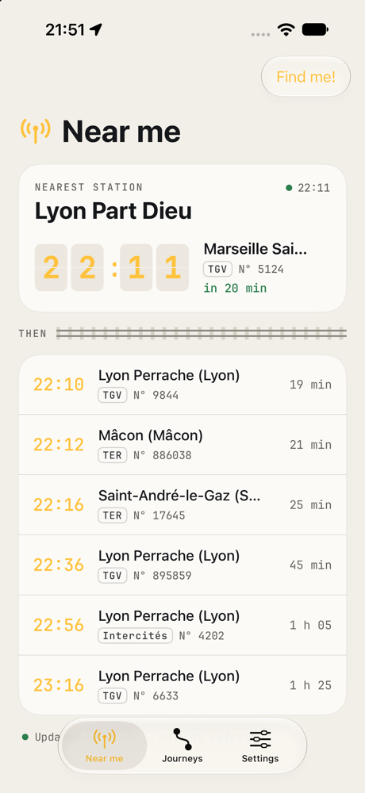
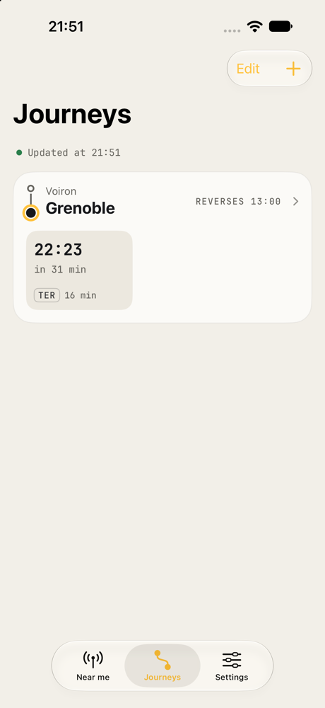
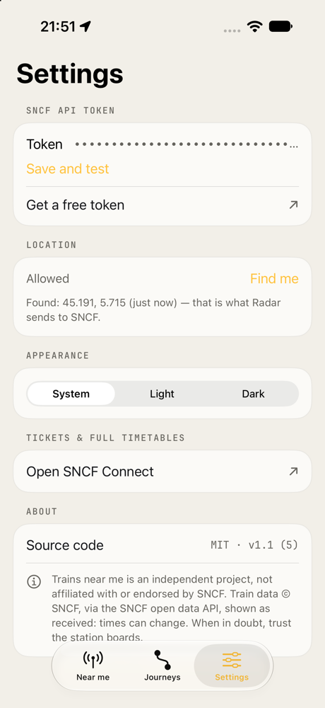

<div align="center">

# Trains near me

**The next SNCF trains — on your Lock Screen, your desktop, and your iPhone.**
Real-time delays and cancellations, straight from the official SNCF API. No backend, no account, no third-party code.

[](https://github.com/Wonskcalb/trains-near-me/actions/workflows/ci.yml)
[](https://github.com/Wonskcalb/trains-near-me/releases/latest)


[](LICENSE)

<picture>
  <source media="(prefers-color-scheme: dark)" srcset="Design/widget-dark.png">
  
</picture>

</div>

## What it is

Two native WidgetKit widgets, and — on iPhone and iPad — a small app wrapped around the same data:

- **Trip** — the next **direct** trains for one journey (e.g. Grenoble → Voiron). You pick the two stations.
- **Radar** — the next departures from the station closest to you, in every direction. Nothing to configure; it follows you.

Everything runs on the device. It talks only to `api.sncf.com` and Apple's location services — there is no server in between, and nothing to sign up for beyond a free SNCF API token.

**Just want to use it?** The step-by-step guide is [GUIDE.md](GUIDE.md). You need Xcode and a free Apple account, and one script builds and installs it:

```bash
sh scripts/install.sh
```

## On your iPhone

A three-tab app, same data as the widgets, in the split-flap "Tableau" look — Light, Dark, or System.

<table>
<tr>
<td align="center" width="33%"><strong>Near me</strong><br><sub>Live departures from the closest station</sub></td>
<td align="center" width="33%"><strong>Journeys</strong><br><sub>Your saved trips, next trains sliding in</sub></td>
<td align="center" width="33%"><strong>Settings</strong><br><sub>Token, location, Light / Dark / System</sub></td>
</tr>
<tr>
<td><picture><source media="(prefers-color-scheme: dark)" srcset="Design/app-nearme-dark.png"></picture></td>
<td><picture><source media="(prefers-color-scheme: dark)" srcset="Design/app-journeys-dark.png"></picture></td>
<td><picture><source media="(prefers-color-scheme: dark)" srcset="Design/app-settings-dark.png"></picture></td>
</tr>
</table>

## On iPad and Mac

Wherever there is room — iPad, iPad split view, and the Mac, which is now a proper window with a menu-bar companion rather than only a settings pane — the app opens into a **big screen** layout: a sidebar and four screens, all keyboard-driven (⌘K search, ⌘R refresh, ⌘1–4 to switch, ↑↓ / Space on the board, Esc to leave Wall mode).

- **Station hall** — the sidebar of your journeys and the nearest station, a journey board with a split-flap next-train hero and a full-width time track, and an inspector that draws the selected train's stopping pattern, with **Watch** and **Share ETA**.
- **Lanes** — every saved journey on one time axis, each train a bar from departure to arrival, delays sliding off a dashed ghost, with a service-day minimap.
- **Wall mode** — a full-screen, always-dark departure board for a pinned station, with a split-flap clock and a "leave home in" countdown, kept awake for a hallway display.
- **Round trip** — the outbound and the way back side by side, with a minimum-stay stepper that finds the first return that fits and can watch both trains.

A **menu-bar extra** on macOS keeps the next train in the bar and the full board a click away, and an **extra-tall widget** turns the time track vertical where iOS / macOS 27 offers the size.

## Highlights

- **A split-flap look.** The iOS app and both widgets wear "Tableau": a departure-board palette in JetBrains Mono, flap tiles for the next time, the route drawn as pins on a line, and a station-board colour code for delays and cancellations. Light and dark are separate palettes, switched as one — never mixed. One iOS setting picks Light, Dark, or System.
- **One journey per Trip widget.** Direction is fixed, reversed, or automatic — automatic flips the journey at a switch time, 13:00 by default. Optionally the configured station closest to you becomes the departure; that comparison happens on the device, nothing is sent.
- **An app on iOS.** The radar full-screen, every saved journey as a card whose next departures slide sideways, and a settings tab. Saved journeys can be edited and swiped away, and they become the suggestions offered when you configure a Trip widget.
- **Lock Screen on iOS.** Both widgets also come in the rectangular and circular accessory sizes.
- **Privacy by default.** A position leaves the device in Radar mode only, rounded to three decimals — about 100 m — to find the station around you. That is the single case where a coordinate is sent anywhere.

> Not affiliated with SNCF. Train data © SNCF, via the [SNCF open data API](https://numerique.sncf.com/startup/api/).

## Layout

```
SNCFCore/   Swift package: domain model, SNCF client + parser, direction/position logic,
            refresh plan, the shared Tableau theme (colours, font, components), and the tests
Widget/     Widget extension: App Intent configuration, timeline provider, SwiftUI views
App/        Host app: big-screen window + menu bar on macOS and iPad, a three-tab app on iPhone, shared settings
Config/     Shared build settings; Local.xcconfig (git-ignored) holds your team id
Design/     App icon renderer, widget screenshot renderer and the rendered images
scripts/    install.sh (build + install), render-screenshots.sh
```

Swift 6 language mode, strict concurrency, no third-party dependencies.

## Setup

<details>
<summary><strong>Build and run (macOS)</strong></summary>

Requires Xcode 16 or later, and macOS 15 or later.

1. **Get a free SNCF API token** at <https://numerique.sncf.com/startup/api/token-developpeur/>. The free tier allows 5,000 requests per day.
2. **Set your signing team.** A free Personal Team is enough to run the widget on your own Mac:
   ```bash
   cp Config/Local.xcconfig.example Config/Local.xcconfig
   ```
   Then edit `DEVELOPMENT_TEAM` and `BUNDLE_ID_PREFIX`. Both targets read them, so they always share the same App Group, which is how the widget reads the token.
3. **Open `TrainsNearMe.xcodeproj` and run the `TrainsNearMe` scheme.** In the window, paste the token and click **Save and test**; accept the location prompt if you want nearest-station mode.
4. **Add a widget:** right-click the desktop › **Edit Widgets** › **Trains near me** › **Trip** or **Radar**. For Trip, right-click the widget › **Edit** to pick the stations.

</details>

<details>
<summary><strong>On iPhone or iPad</strong></summary>

Same project, same scheme: pick your device in Xcode and run. Two differences:

- **The token needs a paid team, or a rebuild.** App Groups are what let the app hand the token to the widget, and a free Apple account does not get one on iOS. With a real team, type the token in the app as on macOS. Without one, compile it in — put this in `Config/Local.xcconfig`, then build again:
  ```
  SNCF_TOKEN = 3b036afe-0110-4202-b9ed-99718476c2e0
  ```
  The app says which of the two applies to your build.
- **Location** is asked for at first launch, as on macOS; Radar needs it.

</details>

<details>
<summary><strong>Regenerating the Xcode project</strong></summary>

The project is generated from `project.yml` with [XcodeGen](https://github.com/yonaskolb/XcodeGen) — it is the source of truth, and Xcode's own edits are overwritten. After editing `project.yml`:

```bash
brew install xcodegen
xcodegen generate
```

</details>

## Display

Rows show the scheduled time, the service on medium and large widgets (TER, TGV, OUIGO, Intercités, Car), then the journey duration (Trip) or the train's direction (Radar), and a status:

| Status | Row style | Badge |
|---|---|---|
| Delay of 0–10 min | Plain | — |
| Delay of 11–19 min | Orange tint | e.g. `+12` |
| Delay of 20 min or more | Red tint | e.g. `+23` |
| Cancelled | Red tint, struck-through time | `CANCELLED` |
| Disrupted, delay unknown | Orange tint | `delay ?` |

SNCF names every TER after its region, so the service label comes from the brand when it is a national one and from the physical mode otherwise — a coach replacing a train ("Car TER") is labelled Car, never TER.


<details>
<summary><strong>Widget-wide states</strong></summary>

| State | When it appears |
|---|---|
| **NO SERVICE** on hazard stripes | Every remaining train of the day is cancelled |
| **End of service** on a night sky | Today's last train has left; shows the first train of the next service day. Trains up to 03:00 count as the previous evening. |
| **No trains** | SNCF found no direct train at all |
| **SNCF data unavailable** | Offline, token missing or rejected, quota reached, server error, or unexpected data. The widget shows the reason. |
| **Data out of date** | Only when nothing is left of the last fetch. Past 30 minutes the trains stay listed, with the timestamp in orange: the schedule still holds, the delays may not. The refresh button fetches again. |
| Orange **Location** line | Nearest-station mode is on but no location was available. The configured order is used instead; clicking the widget opens the app, which refreshes it with a fix. |

</details>

## How it works

<details>
<summary><strong>The SNCF API</strong></summary>

Navitia-based. Docs: <https://doc.navitia.io>. Authentication is HTTP Basic, with the token as the username and an empty password.

- **Trip departures:** `GET /coverage/sncf/journeys?from=…&to=…&data_freshness=base_schedule&max_nb_transfers=0&direct_path=none&min_nb_journeys=12`
- **Radar, the station around you:** `GET /coverage/sncf/coord/{lon};{lat}/places_nearby?type[]=stop_area&distance=20000&count=5`, coordinates rounded to three decimals, ordered by distance.
- **Radar departures:** `GET /coverage/sncf/stop_areas/{id}/departures?from_datetime=…&data_freshness=base_schedule&count=20`
- **Station search:** `GET /coverage/sncf/places?q=…&type[]=stop_area`, used by the Trip widget configuration.

**Why `base_schedule`:** with `realtime`, cancelled trains disappear from the results. With `base_schedule`, every scheduled trip is returned and real-time changes come as linked disruptions. One request therefore gives schedules, delays and cancellations.

**Fields used:**

- `journeys[].status`: `NO_SERVICE` or `SIGNIFICANT_DELAYS`. A station board has no such field, so the severity of the linked disruption plays that role.
- `departures[].stop_date_time.base_departure_time` and `departures[].display_informations.direction`, for the Radar board.
- `display_informations.commercial_mode` and `physical_mode`, reduced to a short service name by `NavitiaParser.mode(commercial:physical:)`.
- `disruptions[].severity.effect`, for disruptions linked from `sections[].display_informations.links[]`.
- `impacted_stops[]`, matched on the origin and destination stop points: `base_departure_time` vs `amended_departure_time` gives the delay; a `deleted` status at either stop means the train counts as cancelled.

**Filtering:** a journey is kept only if it has exactly one `public_transport` section, running from the configured origin to the configured destination. That excludes connections and "walk to another station" itineraries.

</details>

<details>
<summary><strong>Refresh and WidgetKit limits</strong></summary>

- **One reload, one SNCF request** (two for Radar: the station, then its board). The timeline then holds an entry just after each departure, so departed trains drop off, plus an entry at +30 min that turns the timestamp orange because the delays are no longer trustworthy. One fetch therefore keeps the widget right for hours when no reload is granted.
- **A refresh button sits in the header** — a `Button(intent:)` running `RefreshIntent`, which calls `WidgetCenter.reloadAllTimelines()`. App-requested reloads are served immediately, so one click gives fresh delays the moment you open Notification Center.
- **Reloads are asked for when they matter, not on a fixed interval.** WidgetKit grants roughly 40–70 reloads per widget per day; spending them uniformly means spending them at 3 a.m. and running out during the evening rush. So the next reload is asked for 5 min before the next train leaves, bounded by a 20-minute floor (`RefreshPlanner.minimumGap`, the budget knob) and a 60-minute ceiling. After the last train, a single reload is booked just before the first train of the next service day, instead of polling all night. Errors are retried after 15 min. The Trip widget also reloads at the automatic switch time.
- **The system decides when reloads actually happen.** Reloads come late when the Mac sleeps or the widget isn't visible, so delays can be 15–30 min old. This is not a live departure board: the header shows when the data was fetched.
- **Location:** the widget reads the system's cached fix if it is under 15 min old, otherwise waits up to 5 s for one. In Trip mode the coordinates are only compared with the two station coordinates, on the device. In Radar mode they are rounded to about 100 m and sent to `places_nearby`. macOS reliably hands widgets a fix only while the host app is active, so the app reloads the widget every time it opens.

</details>

## Tests

```bash
swift test --package-path SNCFCore
```

The tests make no live API calls — everything is fixtures. They cover direction (fixed, reversed, automatic around 13:00, custom switch time), nearest-station selection, the delay bands and cancellations, journey filtering, the service day (a 00:15 train still counts as tonight, end of service told apart from all-cancelled), response parsing against the fixtures in `SNCFCore/Tests/SNCFCoreTests/Fixtures`, and the refresh plan (the reload budget, entries outliving the stale mark, one reload for the whole night).

## Releasing

Pushing a version tag on `main` builds iOS and macOS and uploads both to TestFlight
(`.github/workflows/release.yml`):

```bash
# bump CURRENT_PROJECT_VERSION in project.yml first: App Store Connect refuses a build number twice
git tag v1.3.0 && git push origin v1.3.0
```

The tag gives the version (1.3.0); the build number is `CURRENT_PROJECT_VERSION`. The workflow stops
before building if the tag isn't on `main` or the build number wasn't bumped since the last tag.
Distributed builds never contain an SNCF token: testers paste their own in Settings.

One-time setup in the repository's **Settings › Secrets and variables › Actions**:

| Name | Kind | Value |
|---|---|---|
| `APPLE_TEAM_ID` | secret | your team id (developer.apple.com › Membership) |
| `BUNDLE_ID_PREFIX` | variable | the bundle id, as in `Config/Local.xcconfig` |
| `ASC_KEY_ID`, `ASC_ISSUER_ID` | secret | from App Store Connect › Users and Access › Integrations › App Store Connect API |
| `ASC_KEY_P8` | secret | the contents of the downloaded `AuthKey_….p8` |
| `DISTRIBUTION_CERT_P12`, `MAC_INSTALLER_CERT_P12`, `CERTS_P12_PASSWORD` | secret, optional | base64 of the *Apple Distribution* and *Mac Installer Distribution* certificates exported from Keychain Access as `.p12`, and their password |

Without the certificate secrets Xcode uses cloud-managed signing, which needs the API key's role to
be **Admin**. The app record in App Store Connect must list both the iOS and the macOS platform.

To try a release locally without uploading: `sh scripts/release.sh ios export` (or `macos`).

## Troubleshooting

<details>
<summary><strong>Common signing and widget problems</strong></summary>

| Symptom | Cause | Fix |
|---|---|---|
| Station search fails with error `0` (token missing) | The app and the widget were signed with different teams, so they use different App Groups | Set `DEVELOPMENT_TEAM` in `Config/Local.xcconfig` only, so both targets get the same team |
| The location prompt never appears; the app stays at "Not requested" | macOS remembers an earlier signing identity for that bundle id | Change `BUNDLE_ID_PREFIX` |
| On iPhone, "Add your SNCF API token…" | A free Apple account cannot share an App Group on iOS | Set `SNCF_TOKEN` in `Config/Local.xcconfig` and build again, or sign with a paid team |
| `An invalid value '$(TeamIdentifierPrefix)…' was provided for the parameter 'identifier'`, then `No profiles … were found` | The App Group is shaped for macOS; `$(TeamIdentifierPrefix)` only exists at signing time, and a paid team makes Xcode register the group on the portal, where the unexpanded variable is rejected | Already handled: `SNCF_APP_GROUP` in `project.yml` carries the team prefix on macOS and a `group.` prefix on iOS. Run `xcodegen generate` if you edited the project by hand |
| The team you picked in Xcode is gone after `xcodegen generate` | The project is generated from `project.yml`; Xcode's own edits are overwritten | Set `DEVELOPMENT_TEAM` in `Config/Local.xcconfig` instead |
| The widget shows an old build, or stops getting a location | `xcodebuild` registers its product in LaunchServices, so a DerivedData copy competes with the installed one — and that copy has its own bundle id, hence no location permission | `lsregister -u <path to the DerivedData app>`, delete that build, then `lsregister -f "/Applications/Trains near me.app"`. Pass `-derivedDataPath` somewhere disposable when building by hand |
| The widget has no **Edit** option | Xcode's debug dylib hides the App Intent from the system | Keep `ENABLE_DEBUG_DYLIB: NO` in `project.yml` |

</details>

## Screenshots

The images in `Design/` are rendered from the real widget views, so they never drift from the code:

```bash
sh scripts/render-screenshots.sh
```

## Contributing

See [CONTRIBUTING.md](CONTRIBUTING.md). Release history is in [CHANGELOG.md](CHANGELOG.md).

## License

[MIT](LICENSE)
